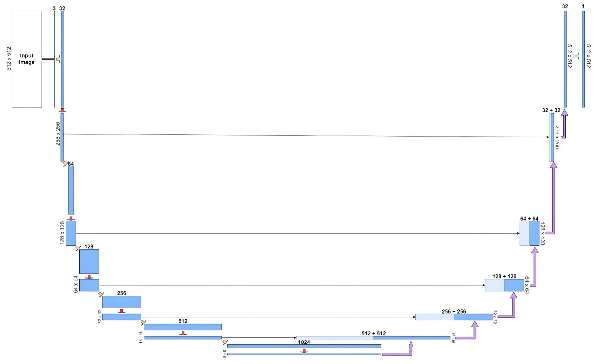
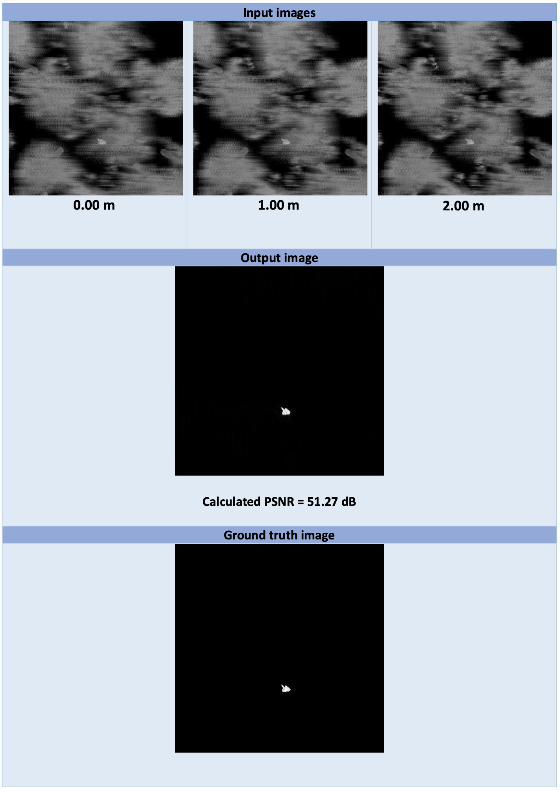

## Problem

From a drone, someone lying, sitting or standing in a forest is basically invisible: leaves and branches cover everything. Airborne Optical Sectioning (AOS) helps by combining many aerial shots into images focused at different heights, but the occlusion is still there. For our JKU Computer Vision Lab project (a team of six, winter 2023/24), the goal was a network that removes it.

## Approach

We got about 33,000 simulated scenes. After throwing out the corrupted ones, we ran the AOS integrator to build a focal stack per scene: three 512×512 images focused at 0 m, 1 m and 2 m, one height each for lying, sitting and standing people.

The model is a U-Net-style CNN autoencoder with 6 encoder and 6 decoder levels, skip connections and 18.7M parameters. Compared to a classic U-Net, it uses one conv per encoder block, padding to keep the image size, and more levels. Training is self-supervised: the clear ground-truth image is the target and the loss is plain MSE. The final run used 24,960 focal stacks (80/20 split), Adam and 21 epochs.

At first we added a second head that predicted the person's pose and shape from the simulation parameters. It didn't help the restoration at all, so we dropped it.

## Result

Validation MSE fell from 0.80 (no restoration) to 0.0014, and the average PSNR on unseen test scenes is 44 dB. The network finds people even where I can't spot them by eye, and shows nobody when nobody is there. It also gave clean results on real drone images.

Limits: it was trained on scenes with one person, so multiple people or animals are untested.

**Tech:** U-Net-style CNN autoencoder · self-supervised image restoration · MSE loss · Adam
<!-- TODO(owner): which framework did you use (PyTorch?). -->
