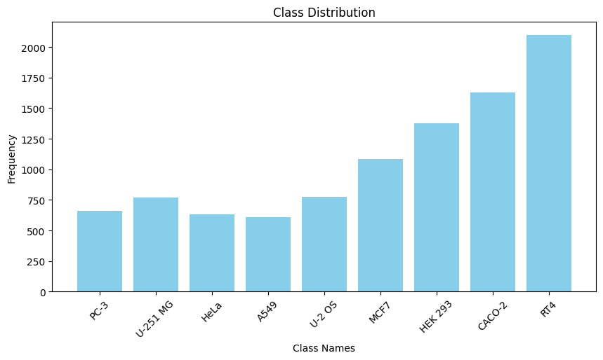
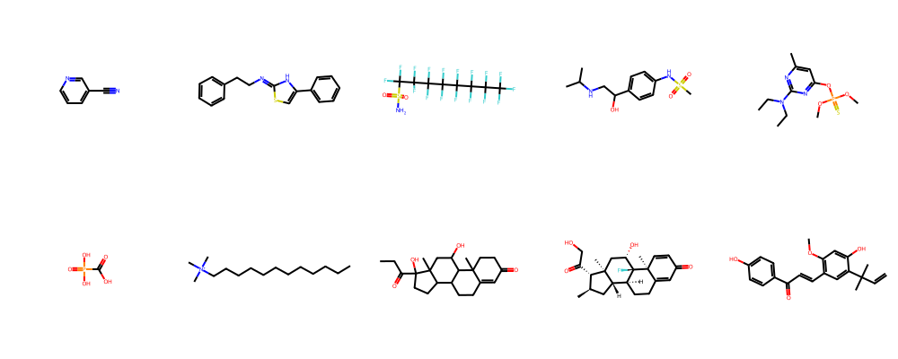

## In short

Three separate projects, collected here because they all apply machine learning to biology and chemistry. Each has its own dataset, its own model and its own score on a hidden test set:

1. **Cancer cell lines** — classify microscopy images into 9 cell lines.
2. **Toxicity** — predict from a molecule's structure whether it is toxic.
3. **Molecule generation** — invent new, valid molecules character by character.

## Cancer cell lines from microscopy

Each sample is a microscopy image in three fluorescence channels — nucleus, microtubules and endoplasmic reticulum — and the task is to say which of 9 cancer cell lines it shows. There are 9,632 training images, spread very unevenly over the 9 classes.

Every bar is one cell line and how many training images it has. RT4 on the right has about 3.5× as many as A549 on the left, and that gap is the problem: a model can score well by leaning towards the big classes and quietly giving up on the small ones.

I stacked the three channels into one RGB image and upsampled the rare classes until every class had 2,100 images, then split 80/20. The training set got heavy augmentation: horizontal and vertical flips, rotations, small shifts and shears, contrast jitter and Gaussian blur. The model is an ImageNet-pre-trained Wide ResNet-101-2 whose final layer I replaced with 9 outputs, fine-tuned end to end with Adam and cross-entropy, stopping once validation accuracy stopped improving. Both losses fell smoothly, with validation below training because augmentation only ran on the training set.

**Result:** 0.90 balanced accuracy on the hidden test set.

## Predicting toxicity from structure

Here the input is a molecule written as a SMILES string, and the task is to predict whether it is toxic in each of 11 lab assays. Most of the 12,000 training molecules were measured in only a few of them, so the labels are sparse.

RDKit parses each string into a molecule and turns it into a 1,024-bit Morgan fingerprint, a vector that records which small atom neighbourhoods occur in it. I treated each assay as its own problem: one Random Forest per assay, trained only on the molecules actually measured in it, with a grid search over tree count, depth and splitting rules under 5-fold cross-validation scored by AUC.

**Result:** mean AUC 0.76 on the hidden test set. Per assay it ranges from 0.63 to 0.93, which says more about how much data each assay had than about the method.

## Inventing new molecules

The last task was to generate new molecules that look like real drug-like ones. The score is the Fréchet ChemNet Distance (FCD), which compares a generated set against a real set in the feature space of a chemistry network — lower is better.

I tokenised roughly a million training SMILES character by character over a 37-symbol alphabet, padded them to equal length with an end token, and trained a Keras model (embedding, two LSTM layers of 256 units with dropout, softmax output) to predict the next character.

To generate, I drew a first character from the distribution of first characters in the training data, then sampled onward from the model's own predictions until it emitted the end token. About 15,000 generated strings passed through RDKit, where roughly 15% turned out to be chemically invalid and were dropped, leaving about 12,700.

**Result:** FCD 0.82, with 0.98 uniqueness and 0.96 novelty — almost none of the kept molecules were copies of training ones.

**Tech:** Python · PyTorch · Wide ResNet-101-2 · scikit-learn · RDKit · Keras · LSTM
