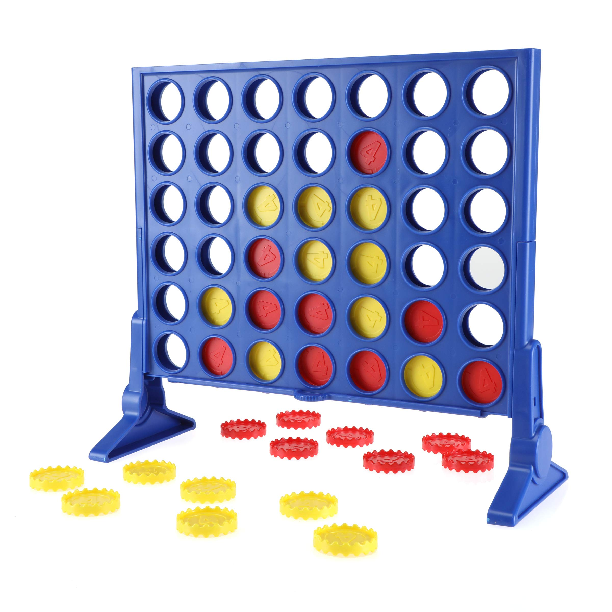

## Problem

A Connect 4 board has 42 positions, so every game state is a point in a 42-dimensional space. That is impossible to look at directly. I wanted to see how games unfold.

## Approach

I recorded thousands of moves from games between an AI player and a random player. Each state is the full 42-position board. I then used UMAP and t-SNE to compress these states down to two dimensions.

## Result

The two methods tell different stories. UMAP shows how the complexity of the game changes over time. t-SNE draws each game as a trajectory, coloured by the winner, so you can follow game paths and see where they end up.

**Tech:** UMAP · t-SNE
