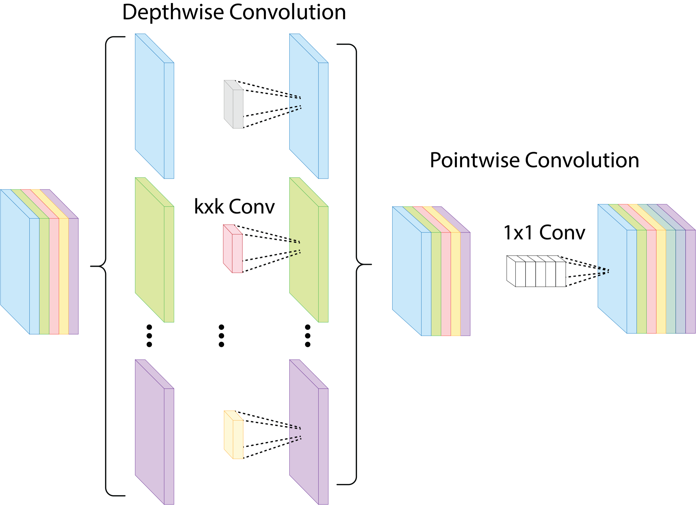

## In short

A collection of smaller PyTorch projects that cover the basics behind everything else on this site: building and training networks, reusing pre-trained ones, going deeper with skip connections, and fitting a useful CNN into very few parameters.

## Problem

Before the bigger projects, I needed solid fundamentals: how to adapt existing architectures, train deeper networks, build small efficient models, and keep experiments under control.

## Approach

- **Basics:** fully connected and convolutional networks on MNIST, compared side by side.
- **Transfer learning:** an ImageNet-pre-trained VGG adapted to CIFAR-10. The feature extractor stays frozen and only a new classifier is trained.
- **Deeper networks:** pre-activation residual blocks, where the skip connection bypasses the activation for a cleaner gradient path.
- **Efficient CNNs:** a CIFAR-10 model under 30K parameters, built from depthwise separable convolutions, skip connections and squeeze-and-excitation layers that reweight each channel.
- **Training tooling:** a small trainer with progress bars, TensorBoard logging, checkpoints and hyperparameter search.

## Result

A set of reusable building blocks and training tools that the later projects build on.

**Tech:** Python · PyTorch · VGG · residual networks · CIFAR-10 · TensorBoard
