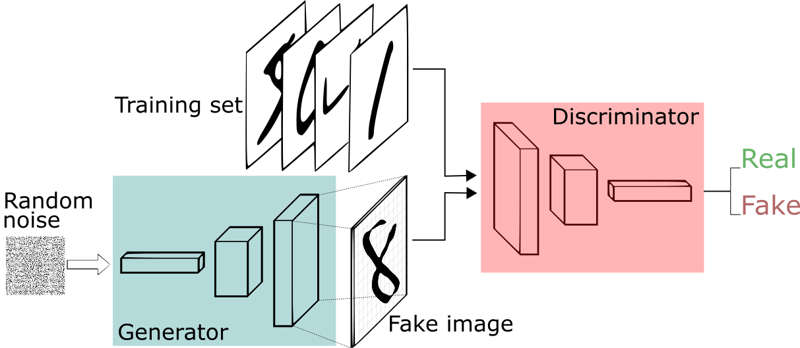

## In short

I built a GAN in PyTorch that learns to draw handwritten digits, and on the way I looked at the other meaning of "adversarial": how easily a trained classifier can be fooled.

## Problem

A classifier that recognises digits doesn't really *understand* them. Small, targeted changes to an image can make it fail. The same trick, aimed at the right network, can also be used to create new images.

## Approach

**Fooling a classifier.** I trained a small CNN on MNIST, then attacked it with projected gradient ascent: nudge the pixels in the direction that increases the loss, but keep every change within a small budget so the digit still looks like itself.

**From attacks to generation.** Next I trained a discriminator to tell real digits from fakes. The fakes start as noise, and after every epoch the same attack pushes them to look more "real". Better fakes make a stronger discriminator, and the other way round.

**The GAN.** Finally, a generator network replaces the attack. It turns random vectors into images and is trained to fool the discriminator, while the discriminator is trained to catch it: a min-max game. Each network is updated only with its own loss.

## Result

Small, bounded changes to the pixels are enough to make the classifier get digits wrong. The GAN learns to turn random noise into new digits.

**Tech:** Python · PyTorch · CNNs · projected gradient ascent · GAN
