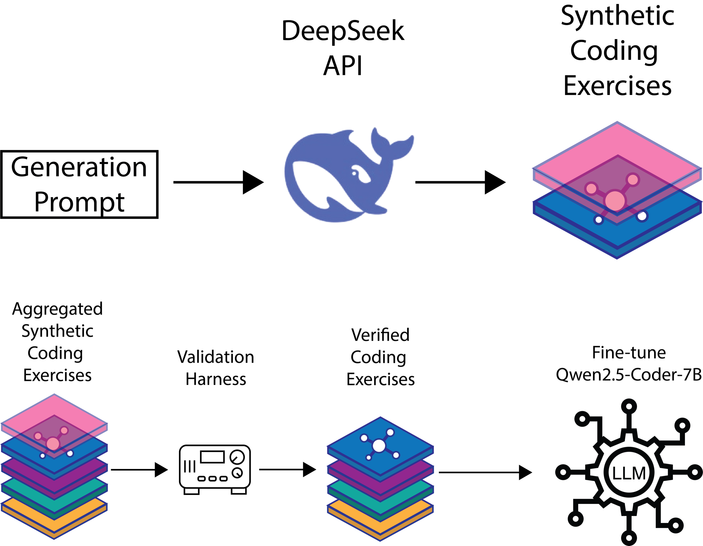

## In short

I fine-tuned Qwen2.5-Coder-7B to edit code in the exact diff format the Aider coding assistant expects. The key was the data: 2,777 synthetic coding tasks in six languages, each one checked by actually running its tests.

## Problem

I wanted a 7B open model that could solve coding exercises in six languages and pass Aider's Polyglot benchmark. Off the shelf, it often failed to produce edits in the format Aider expects, and it solved only about 2–3% of the benchmark.

My first attempt trained on real commit messages paired with their diffs. It made things worse: the pass rate dropped to 1.8%, and to 0.4% in a second run. Commit history simply doesn't look like the task.

## Approach

So I built my own training data. Using the DeepSeek API and a custom prompt, I generated 3,000 Exercism-style tasks, each with a stub, a solution, tests and a short plan. To keep them varied, every task got a random topic from a list of 48 (from string parsing and ring buffers to dynamic programming) and a difficulty level, spread evenly over Python, JavaScript, C++, Rust, Go and Java.

Then I wrote a test harness that runs every sample with its language's own test tool: pytest, Jest, Catch2, cargo test, go test and JUnit. A sample was kept only if:
- its diff applies cleanly, checked with Aider's own diff code,
- its tests pass on the solution *and* fail on the stub.

That left 2,777 verified samples. Most rejects were solutions that failed their own tests.

For training I used QLoRA (4-bit, rank 16) with Unsloth on rented Vast.ai GPUs, and wrapped every input in Aider's real prompt layout so the model learned the exact format it would see at evaluation time.

## Result

Well-formed diffs rose from **49% to 75%**. Training on commit data had made the model worse; small, task-shaped and test-verified data made it better.

<!-- TODO(owner): the slide sentence is cut off ("…which"); finish the lesson learned. -->

**Tech:** Qwen2.5-Coder-7B · QLoRA · Unsloth · DeepSeek API · Vast.ai · Aider Polyglot
