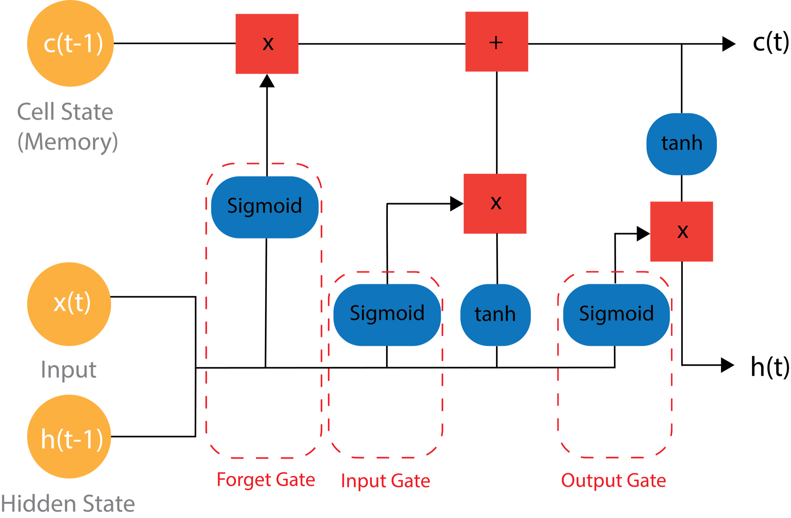

## In short

I trained a character-level LSTM in PyTorch on transcripts of Donald Trump's speeches. It reads text one character at a time and predicts the next one. I used those predictions twice: to write new text, and to compress text by giving the characters it expects the shortest codes.

## Problem

A model that predicts the next character well has learned the structure of a language. Generating text shows that directly; compression puts a number on it: better predictions, fewer bits per character.

## Approach

The text is split into non-overlapping sequences, and each character is mapped to an index in a small alphabet (letters, digits, space and . ! ?). Unknown characters become spaces.

The model has three layers: a learned **embedding** turns each character into a vector, an **LSTM** carries a memory along the sequence, and a linear layer outputs a score for every character in the alphabet. Training is many-to-many: the target is the input shifted by one character, so the model predicts at every position. It uses cross-entropy loss and Adam, and the checkpoint with the lowest validation loss is kept. I also measured top-k accuracy for every k: how often the true next character is among the model's k best guesses.

**Generation:** starting from a seed like "I am a", the next character is sampled with the **Gumbel-Max trick**: add Gumbel noise to the temperature-scaled scores and take the largest. The temperature τ sets how adventurous the text gets.

**Compression:** a Huffman code gives frequent symbols short bit strings and rare ones long ones. The baseline builds one fixed code from character frequencies in the training text. The LSTM version builds a new Huffman code at every step from the model's predicted probabilities, so the expected next character costs only a few bits. I tuned a softmax temperature for this and compared bits per character on the validation set.

## Result

The LSTM writes new text character by character, and its predictions drive an adaptive compression scheme.

<!-- TODO(owner): add bits per character (static vs. LSTM), best temperature, top-k accuracy or a sample output if available. -->

**Tech:** Python · PyTorch · LSTM · Gumbel-Max sampling · Huffman coding
