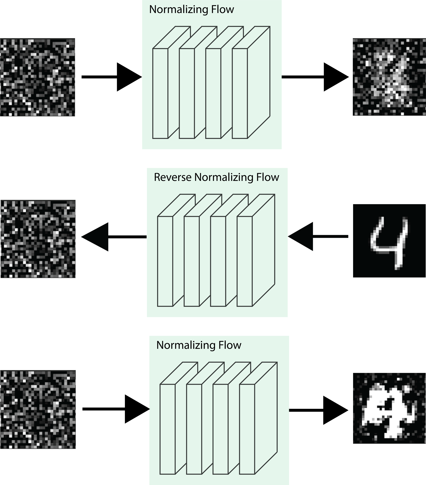

## In short

I built a normalising flow in PyTorch: a stack of invertible layers that turns MNIST digits into Gaussian noise. Run it backwards, and noise turns into new digits.

## Problem

Most generative models can sample new data but can't tell you how likely a given example is. Normalising flows can do both, because every step is invertible. The catch: ordinary neural networks aren't.

## Approach

I flattened MNIST digits into 784-dimensional vectors and built the flow from 5 **additive coupling layers**. Each one splits the pixels in half, keeps one half as it is and shifts the other by an amount a small network computes from the first. That is easy to undo, and the halves swap from layer to layer so every pixel gets transformed.

Using the change-of-variables formula, the model is trained by maximum likelihood: it minimises the negative log-likelihood of the digits under a standard Gaussian, including the log-determinants of the Jacobians.

## Result

To generate a digit, I sample from the Gaussian and run it backwards through the flow. Out come new digits.

**Tech:** Python · PyTorch · additive coupling layers · maximum-likelihood training
