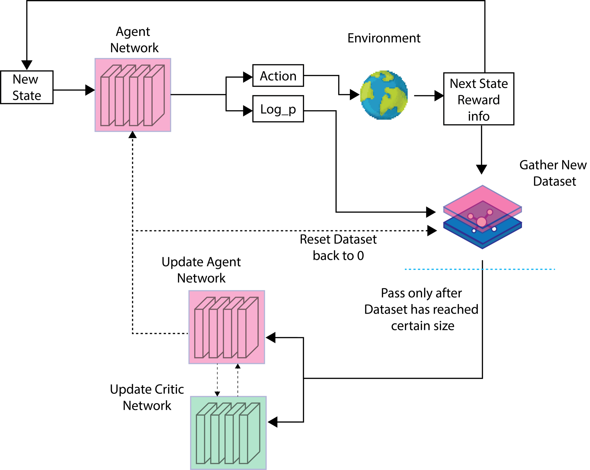
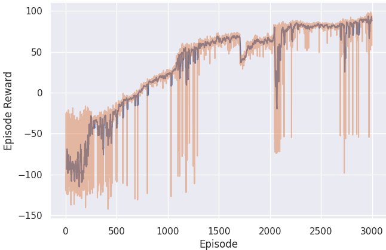

## In short

I taught a simulated two-legged robot to walk from scratch. It starts out flailing and falling over, and is only rewarded for moving forward and penalised for falling. I implemented the Proximal Policy Optimization (PPO) algorithm myself in PyTorch, and after 3,000 episodes of trial and error the robot walks steadily.

## Problem

BipedalWalker (Gymnasium, Box2D) observes a 24-dimensional sensor vector: hull angle, velocities, joint positions and lidar readings. Each step it must output four continuous torques, one per hip and knee joint. Continuous actions rule out simple value-based methods like DQN, so the agent has to learn a stochastic policy directly.

## Approach

PPO uses two networks. The **Actor** (policy) maps the state to a Gaussian over actions: it outputs a mean and, via softplus, a standard deviation for each joint. The **Critic** estimates the state value V(s). Both are MLPs with two hidden layers of 376 units, LayerNorm and ReLU.

Training alternates between two phases. The current policy collects 4,048 transitions into a rollout buffer. Then actor and critic train on that buffer for 5 epochs in minibatches of 32, and the buffer is cleared. The advantage is the one-step TD error r + γV(s′) − V(s) with γ = 0.99. The policy loss is PPO's clipped surrogate objective (ε = 0.2), which stops a single update from moving the policy too far. The value loss is a Huber loss, and a small entropy bonus keeps exploration alive. The loss weights (1, 1, 0.0015) and a low learning rate of 1e-5 with Adam took the most tuning, along with getting right which tensors to detach from the gradient graph.

## Result

The episode reward climbs from around −100, when the robot keeps falling over, to about +100 by episode 3,000. The occasional sharp dips are episodes where it still falls. The trained actor was exported to ONNX.

  <figure>
    <video src="/videos/ppo-bipedal-walker/ppo_start.mp4" autoplay muted loop playsinline controls preload="metadata" aria-label="BipedalWalker after the first training attempts"></video>
    <figcaption>After the first attempts.</figcaption>
  </figure>
  <figure>
    <video src="/videos/ppo-bipedal-walker/ppo_final.mp4" autoplay muted loop playsinline controls preload="metadata" aria-label="BipedalWalker after the improved training process"></video>
    <figcaption>After improving the training process.</figcaption>
  </figure>

**Tech:** Python · PyTorch · Gymnasium (Box2D) · PPO · actor-critic · ONNX
