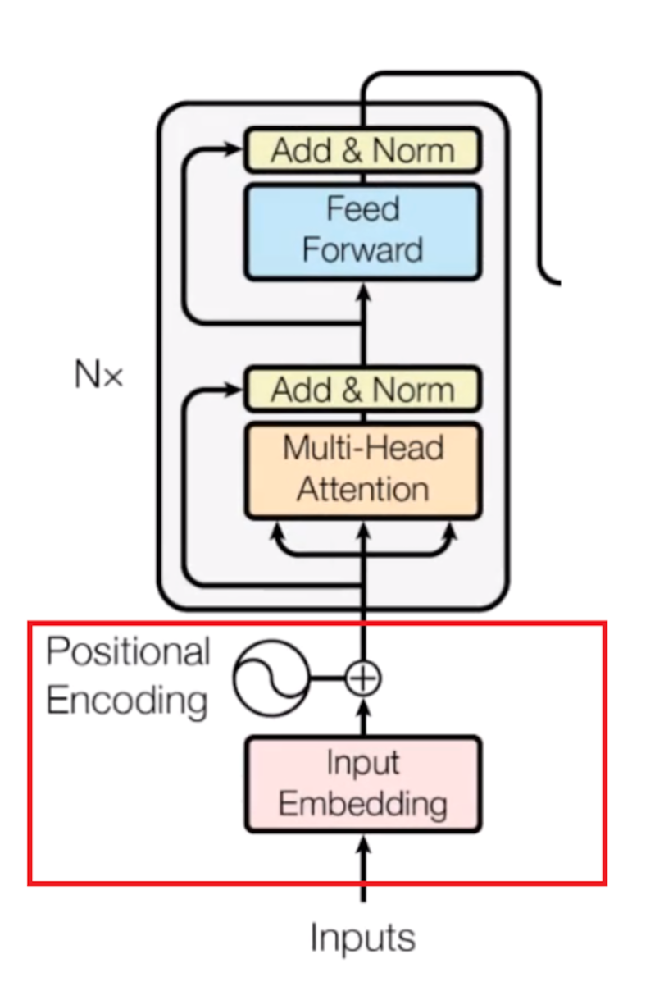

## In short

I built a small GPT-style transformer from scratch in PyTorch and trained it on transcripts of Donald Trump's speeches. It reads up to 64 characters and predicts the next one. Repeating that step, it writes new text one character at a time, and a temperature setting decides whether the output plays it safe or gets creative.

## Problem

Transformers power today's language models. I wanted to understand every piece by building one at the smallest useful scale. Working on characters instead of words keeps the vocabulary tiny: the text is lowercased and reduced to 40 symbols (letters, digits, space and . ! ?).

## Approach

Each character gets a learned token embedding plus a learned position embedding, so the model knows the order of its input. Then come 4 transformer blocks with hidden size 128 and 4 attention heads. Each block applies LayerNorm, **causal multi-head self-attention**, LayerNorm again, and an MLP that widens to 4× with GELU. Residual connections run around both parts.

Inside attention, every character produces a query, key and value. Scaled query-key scores decide how much each character draws from the others. Scores for future positions are set to −∞ before the softmax, so a prediction can only use what came before it. The heads split the hidden dimension and learn different patterns in parallel.

The output layer shares its weights with the token embedding (weight tying), and the loss is cross-entropy on the next character. Training uses AdamW with weight decay on weight matrices only, a learning rate warmed up over 100 steps and then cosine-decayed from 1e-3 to 1e-4, gradient clipping at 1.0, and gradient accumulation over 40 micro-batches of 12 sequences. The checkpoint with the lowest validation loss is kept.

## Result

Given the prompt "the president", the model continues it character by character. I sampled at temperatures from 0.01 to 5.0: low temperatures give predictable text, high temperatures more creative and chaotic text.

<!-- TODO(owner): add a sample output and the final validation loss if available. -->

**Tech:** Python · PyTorch · GPT-style decoder · causal multi-head attention · AdamW
