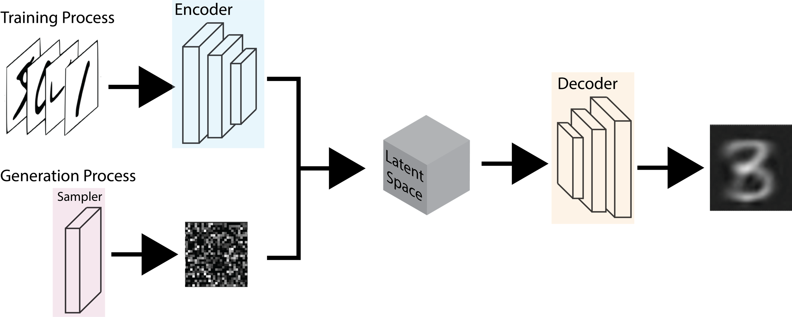

## In short

I worked my way from "undoing" convolutions to a variational autoencoder in PyTorch: first an autoencoder that compresses and rebuilds MNIST digits, then a VAE whose latent space is smooth enough to sample brand-new digits from.

## Problem

A plain autoencoder compresses images, but its latent space has gaps, so you can't sample new images from it. A variational autoencoder fixes that.

## Approach

**Undoing convolutions.** To see how a decoder can reverse an encoder, I first used transposed convolutions and max-unpooling to project the strongest activations of a pre-trained AlexNet back into the input image, showing what each layer reacts to.

**Autoencoder.** Next, a convolutional autoencoder: two convolutions and average pooling squeeze each digit into a small code, and a mirrored decoder of transposed convolutions rebuilds it.

**VAE.** Finally, the encoder predicts a mean and a log-variance for a 20-dimensional latent code instead of a single point. The reparameterization trick keeps this sampling step differentiable, so the whole model trains end to end. A KL term pulls the latent space towards a standard normal, and its weight balances it against reconstruction quality.

## Result

Because the latent space stays close to a standard normal, I can sample from it and decode the samples into new digits.

**Tech:** Python · PyTorch · transposed convolutions · VAE · reparameterization trick
