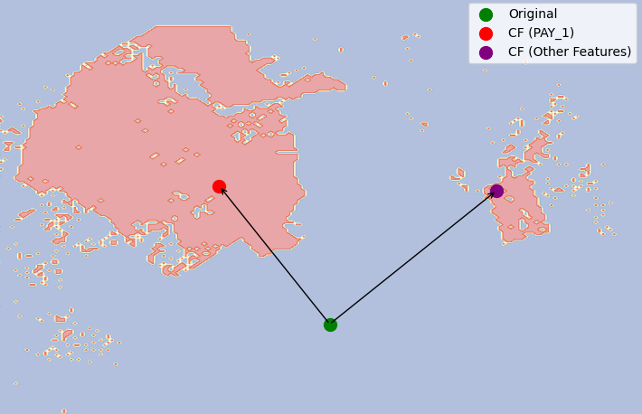

## Problem

A model that predicts credit-card default is only useful if people can understand its decisions. Banks need to spot early warning signs, and they must be able to show that a decision isn't based on gender, age or marital status. We wanted to know what actually drives the predictions.

## Approach

We used 30,000 Taiwanese credit-card clients with six months of payment history, bill amounts, credit limits and demographics. The model is a Random Forest, tuned by grid search with 5-fold cross-validation on F1.

Then we explained it from five complementary angles:
- **Global surrogate:** a single decision tree that imitates the forest
- **LIME** and **SHAP** for individual predictions and global feature importance
- **Partial Dependence Plots** to see how one feature shifts the default probability
- **Counterfactuals** with DiCE, projected into 2D with UMAP

**PAY_1** is the repayment status in the most recent month: −1 means paid on time, 1–9 means payment delayed by that many months.

For the counterfactuals, we mapped the forest's decisions onto a 2D UMAP plane: red where it predicts default, blue where it doesn't. Then we took clients who paid and asked what the smallest change is that flips them to "default". Changing only PAY_1 moves them straight into the large red region. Changing everything else (age, bill amount, credit limit) only reaches a small island, and only with implausible values like large negative bills and ages around 70.

## Result

All five methods agree: PAY_1 dominates. The surrogate tree splits on it first, and the default probability jumps when the delay goes from two to three months. Gender, education and marital status have almost no effect, so we found no discriminatory behaviour. The counterfactuals also exposed blind spots where the model extrapolates from sparse data.

**Tech:** Random Forest · scikit-learn · SHAP · LIME · DiCE · UMAP · Partial Dependence Plots
